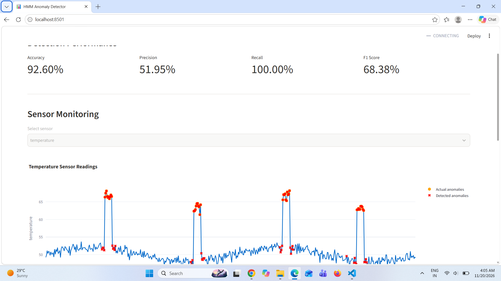

# HMM-Based Machine Anomaly Detector

This project uses a Gaussian Hidden Markov Model to detect unusual patterns in simulated machine sensor readings.

## Features
- Synthetic sensor data generation
- Data preprocessing and standardization
- Gaussian HMM training
- Hidden-state selection using BIC
- Sliding-window anomaly detection
- Model evaluation using accuracy, precision, recall and F1-score
- Interactive Streamlit dashboard

## Dataset
Synthetic temperature, vibration and pressure readings with labeled anomalies.

## Run
python main.py

## Dashboard
streamlit run dashboard/app.py

## Technologies
Python, NumPy, Pandas, Scikit-learn, hmmlearn, Plotly and Streamlit.

## Dashboard Preview

The project includes an interactive Streamlit dashboard for monitoring sensor readings and visualising detected anomalies.

## Performance Results

The model was evaluated using a simulated test dataset containing 40 anomalous readings.

| Metric | Result |
|---|---:|
| Accuracy | 92.60% |
| Precision | 51.95% |
| Recall | 100.00% |
| F1 Score | 68.38% |

## Project Structure

- `main.py` - Main project execution
- `src/` - Data generation, model training, detection and evaluation
- `dashboard/` - Streamlit dashboard
- `data/` - Generated sensor datasets
- `models/` - Trained HMM model
- `outputs/` - Anomaly detection results
- `screenshots/` - Dashboard screenshot
